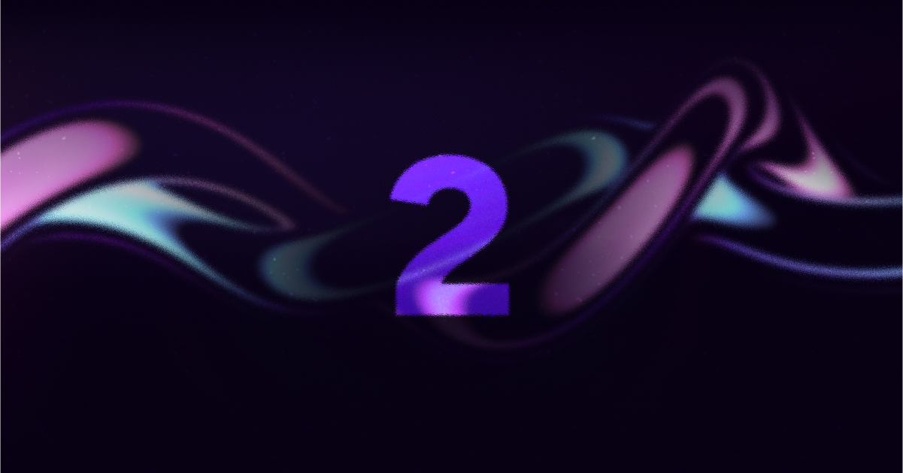

# 网页动效（视频里推荐的 4 个）

做独立站、游戏官网的"高级感"动效骨架：平滑滚动 + 滚动驱动动画 + 现成动效组件。视频里推荐的就是这一组。

## 适合用在

独立站落地页、游戏官网、作品集；录屏后可当视频片头/转场。

## 工具 / 资源

| 工具 | 链接 | 许可证 | 用途 | 状态 |
|---|---|---|---|---|
| Lenis | [darkroomengineering/lenis](https://github.com/darkroomengineering/lenis) | MIT | 平滑滚动 | 已实测 |
| GSAP + ScrollTrigger | [greensock/GSAP](https://github.com/greensock/GSAP) | GSAP 标准免费许可（所有插件免费，非 MIT） | 动画引擎、滚动动画、SplitText、MorphSVG | 已实测 |
| React Bits | [DavidHDev/react-bits](https://github.com/DavidHDev/react-bits) | MIT + Commons Clause（可商用，不可转卖组件） | 约 210 个动效组件：文字/背景/卡片/光标 | 已实测 6 个组件 |
| Cameras UI | 未确认 | — | 视频里提到，名字可能是听写误差 | 待确认 |
| Magic UI | [magicuidesign/magicui](https://github.com/magicuidesign/magicui) | MIT | shadcn 风格动效组件 | 已核对 |
| Uiverse Galaxy | [uiverse-io/galaxy](https://github.com/uiverse-io/galaxy) | MIT | 3800+ 纯 CSS 按钮/卡片/加载动画 | 已核对 |

## 怎么复现示例

解压 `lenis-gsap-reactbits-demo-src.tar.gz`，`npm i && npm run dev`。核心接法：`lenis.on("scroll", ScrollTrigger.update)` + `gsap.ticker.add(t => lenis.raf(t*1000))`。

## 按「不要做原则」使用

对应 [不要做原则](../../../04_规则与模板/不要做原则.md)。

- 不要劫持滚动：Lenis 只做惯性平滑，不分页、不改方向；`prefers-reduced-motion: reduce` 时不初始化 Lenis（demo 源码已这样改，并实测开启“减少动效”后键盘能滚到页脚）。（§7）
- 别做成 AI 默认模板：Inter + 紫色渐变 + 居中大标题 + 三张图标卡。demo 里的极光紫渐变只是技术测试，正式站点按 styles/ 里的风格定主色。（§1）
- 入场动画编排一次就好，不要每个区块都淡入。（§1）

## 官方展示图（official/）

直接取自各项目 GitHub 仓库的官方图，代表素材本来的质量。

React Bits 官网演示图 · David Haz · [来源](https://github.com/DavidHDev/react-bits) · MIT + Commons Clause

React Bits 官网演示图 · David Haz · [来源](https://github.com/DavidHDev/react-bits) · MIT + Commons Clause

React Bits 官网演示图 · David Haz · [来源](https://github.com/DavidHDev/react-bits) · MIT + Commons Clause

## 可直接用的素材文件

- [lenis-gsap-reactbits-demo-src.tar.gz](lenis-gsap-reactbits-demo-src.tar.gz)

## 工具实测（tool-tests/）

我测试时做的拼图、录屏和截图，证明素材能用、方便复现，不代表素材本身的最好效果。

- [demo-screens.png](tool-tests/demo-screens.png)
- [demo-scroll.mp4](tool-tests/demo-scroll.mp4)
