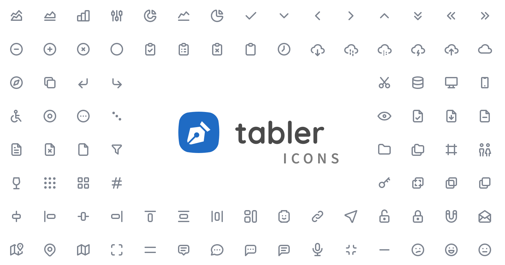

# 图标

UI 图标和品牌 logo。站点主图标建议 Lucide 或 Phosphor 二选一，保持线宽统一。

## 适合用在

独立站、游戏 UI 菜单、视频字幕旁的小图标。

## 工具 / 资源

| 工具 | 链接 | 许可证 | 用途 | 状态 |
|---|---|---|---|---|
| ui-icons-hub（215 套图标聚合，支持中文搜索） | [sitong-zhang/farewell](https://github.com/sitong-zhang/farewell) · [在线](https://sitong-zhang.github.io/ui-icons-hub/) | 按每套上游许可 | 找图标的总入口 | 已实测 |
| Lucide | [lucide-icons/lucide](https://github.com/lucide-icons/lucide) | ISC | ~2400 线性图标 | 已实测 |
| Tabler Icons | [tabler/tabler-icons](https://github.com/tabler/tabler-icons) | MIT | ~6400 线性+填充 | 已实测 |
| Phosphor | [phosphor-icons/core](https://github.com/phosphor-icons/core) | MIT | 6 种粗细 | 已核对 |
| Heroicons | [tailwindlabs/heroicons](https://github.com/tailwindlabs/heroicons) | MIT | Tailwind 官方配套 | 已核对 |
| Lobe Icons | [lobehub/lobe-icons](https://github.com/lobehub/lobe-icons) | MIT（品牌商标归各方） | AI 品牌 logo（Claude/OpenAI/可灵/MJ…） | 已实测 |

## 按「不要做原则」使用

对应 [不要做原则](../../../04_规则与模板/不要做原则.md)。

- 同一产品只用一套图标（线宽、圆角统一），不要 Lucide 和 Tabler 混用。（§3）
- Lobe Icons 里是别人的商标，只用来指代对应产品。

## 官方展示图（official/）

直接取自各项目 GitHub 仓库的官方图，代表素材本来的质量。

Tabler Icons 官方展示图 · Paweł Kuna · [来源](https://github.com/tabler/tabler-icons) · MIT

Tabler Icons 线性图标条 · Paweł Kuna · [来源](https://github.com/tabler/tabler-icons) · MIT

## 可直接用的素材文件

- [gamepad-2.svg](gamepad-2.svg)
- [shopping-cart.svg](shopping-cart.svg)
- [sparkles.svg](sparkles.svg)
- [tb-device-gamepad-2.svg](tb-device-gamepad-2.svg)
- [tb-movie.svg](tb-movie.svg)
- [tb-shopping-cart.svg](tb-shopping-cart.svg)
- [video.svg](video.svg)

## 工具实测（tool-tests/）

我测试时做的拼图、录屏和截图，证明素材能用、方便复现，不代表素材本身的最好效果。

- [preview-ai-logos.png](tool-tests/preview-ai-logos.png)
- [preview-ui-icons.png](tool-tests/preview-ui-icons.png)
