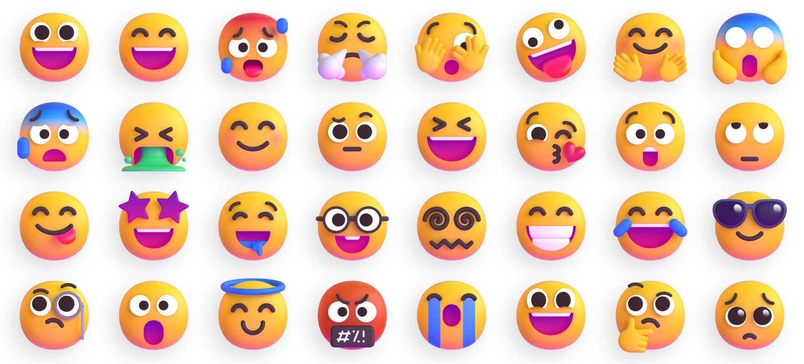

# 3D / 动态 Emoji 贴纸

立体感强的 emoji，做视频贴纸、落地页插图、游戏成就图标都很好用。

## 适合用在

视频贴纸和片头、独立站插图、游戏成就/奖励弹窗。

## 工具 / 资源

| 工具 | 链接 | 许可证 | 用途 | 状态 |
|---|---|---|---|---|
| Fluent Emoji（微软） | [microsoft/fluentui-emoji](https://github.com/microsoft/fluentui-emoji) | MIT | 3D PNG + 彩色/扁平 SVG | 已实测 |
| Noto 动态 Emoji（Google） | https://googlefonts.github.io/noto-emoji-animation/ | CC BY 4.0（需署名） | 动态 webp/Lottie，可商用 | 已实测下载 |
| Animated Fluent Emojis | [Tarikul-Islam-Anik/Animated-Fluent-Emojis](https://github.com/Tarikul-Islam-Anik/Animated-Fluent-Emojis) | 仅限个人使用 | ❌ 商用别用 | 已核对 |

## 怎么复现示例

Noto 动态版下载地址：`https://fonts.gstatic.com/s/e/notoemoji/latest/<码点>/512.webp`，例如 🔥 是 `1f525`。

## 按「不要做原则」使用

对应 [不要做原则](../../../04_规则与模板/不要做原则.md)。

- 同一画面不要混用 Fluent 和 Noto 两套 emoji。（§3）
- Animated Fluent Emojis 仅限个人使用，商用换 Noto 动态版并署名（CC BY 4.0）。

## 官方展示图（official/）

直接取自各项目 GitHub 仓库的官方图，代表素材本来的质量。

Fluent Emoji 官方横幅 · Microsoft · [来源](https://github.com/microsoft/fluentui-emoji) · MIT

## 可直接用的素材文件

- [fluent-crossed_swords_3d.png](fluent-crossed_swords_3d.png)
- [fluent-fire_3d.png](fluent-fire_3d.png)
- [fluent-rocket_3d.png](fluent-rocket_3d.png)
- [fluent-shopping_cart_3d.png](fluent-shopping_cart_3d.png)
- [fluent-sparkles_3d.png](fluent-sparkles_3d.png)
- [fluent-video_game_3d.png](fluent-video_game_3d.png)
- [noto-animated-1f389.webp](noto-animated-1f389.webp)
- [noto-animated-1f525.webp](noto-animated-1f525.webp)
- [noto-animated-1f680.webp](noto-animated-1f680.webp)
- [noto-animated-2728.webp](noto-animated-2728.webp)

## 工具实测（tool-tests/）

我测试时做的拼图、录屏和截图，证明素材能用、方便复现，不代表素材本身的最好效果。

- [preview-fluent-3d.png](tool-tests/preview-fluent-3d.png)
