# 游戏素材（3D 角色 / 场景 / 游戏图标）

可商用的低多边形 3D 角色、场景件和游戏道具图标。

## 适合用在

独立游戏原型和正式版、游戏官网角色展示、视频里的 3D 角色镜头。

## 工具 / 资源

| 工具 | 链接 | 许可证 | 用途 | 状态 |
|---|---|---|---|---|
| KayKit 冒险者角色包 | [KayKit-Game-Assets/KayKit-Character-Pack-Adventures-1.0](https://github.com/KayKit-Game-Assets/KayKit-Character-Pack-Adventures-1.0) | CC0 | 5 个已绑骨角色、76 个动画，glb/gltf/fbx | 已实测（three.js 加载播放） |
| KayKit 地牢包 | [KayKit-Game-Assets/KayKit-Dungeon-Remastered-1.0](https://github.com/KayKit-Game-Assets/KayKit-Dungeon-Remastered-1.0) | CC0 | 地牢墙地板道具 | 已核对 |
| game-icons.net | [game-icons/icons](https://github.com/game-icons/icons) | CC BY 3.0（需署名） | 4000+ 道具/技能 SVG | 已实测 |
| Kenney | https://kenney.nl/assets | CC0 | 2D/3D/UI/音效全套 | 未测（云端访问不到） |
| Quaternius | https://quaternius.com | CC0 | 低多边形角色/动物/场景 | 未测 |
| Poly Haven | https://polyhaven.com | CC0 | HDRI、PBR 材质、写实模型 | 未测 |

## 注意

game-icons 的 SVG 自带黑底方块，要透明的话删掉第一个 `<path d="M0 0h512v512H0z"/>`。

## 按「不要做原则」使用

对应 [不要做原则](../../../04_规则与模板/不要做原则.md)。

- 优先用 CC0 成套资源（KayKit、Kenney）保证风格统一。（§6）
- AI 生成的 3D 不能直接进引擎：先重拓扑、展 UV、烘焙贴图、控制面数。（§6）
- AI 占位图文件名加 `_AI占位` 前缀，打包前扫描。（§2、§6）
- game-icons 是 CC BY 3.0，致谢页要署名。

## 官方展示图（official/）

直接取自各项目 GitHub 仓库的官方图，代表素材本来的质量。

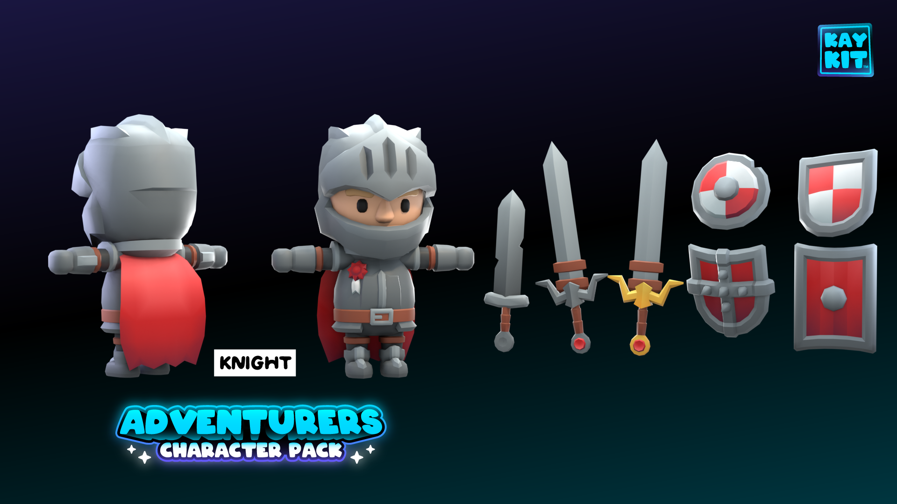

KayKit Adventurers · knight · Kay Lousberg · [来源](https://github.com/KayKit-Game-Assets/KayKit-Character-Pack-Adventures-1.0) · CC0

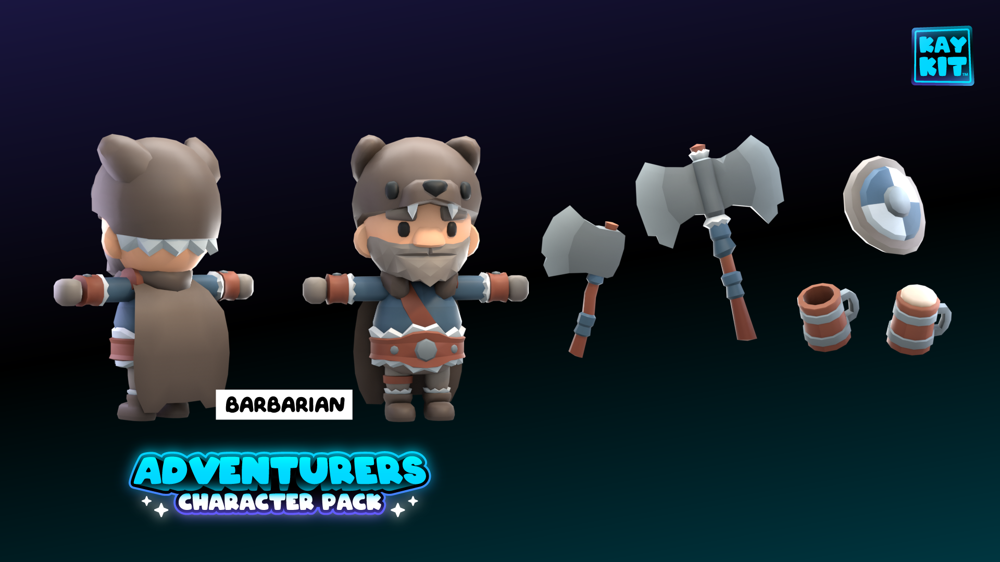

KayKit Adventurers · barbarian · Kay Lousberg · [来源](https://github.com/KayKit-Game-Assets/KayKit-Character-Pack-Adventures-1.0) · CC0

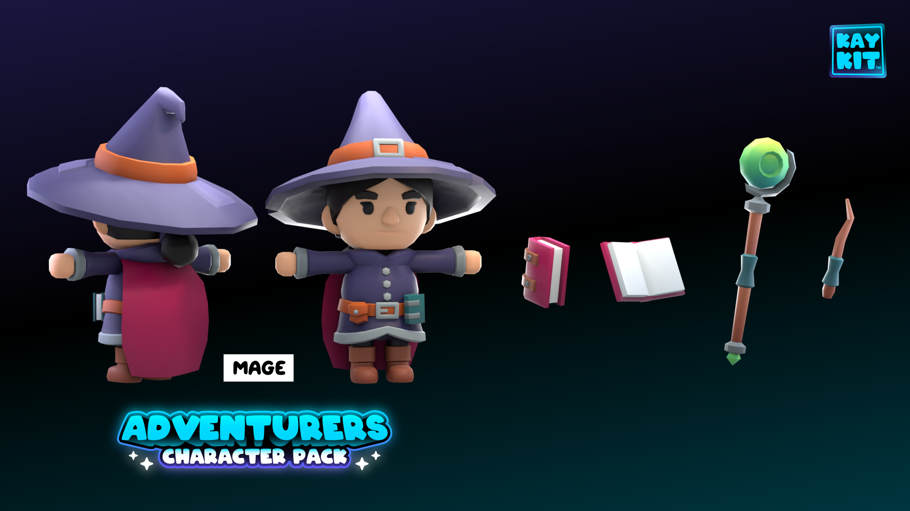

KayKit Adventurers · mage · Kay Lousberg · [来源](https://github.com/KayKit-Game-Assets/KayKit-Character-Pack-Adventures-1.0) · CC0

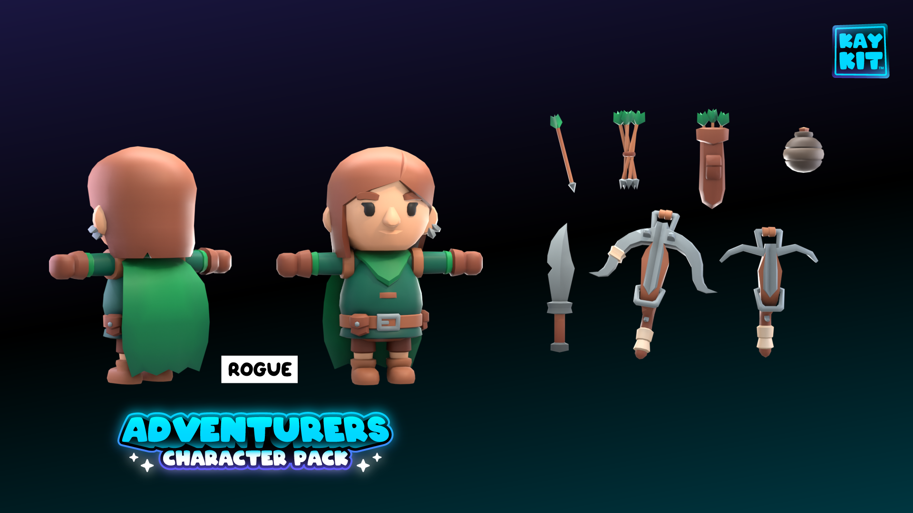

KayKit Adventurers · rogue · Kay Lousberg · [来源](https://github.com/KayKit-Game-Assets/KayKit-Character-Pack-Adventures-1.0) · CC0

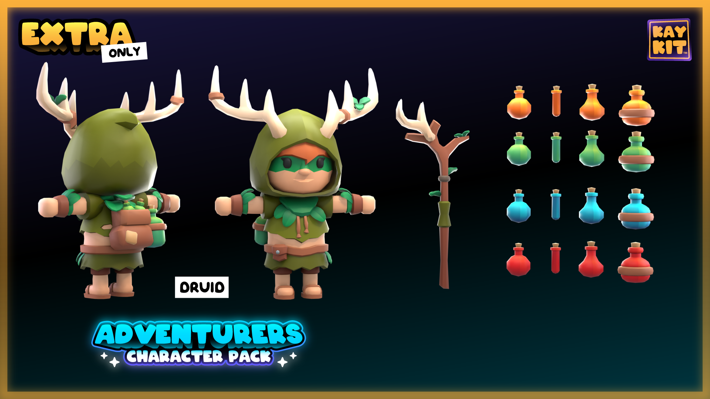

KayKit Adventurers · druid · Kay Lousberg · [来源](https://github.com/KayKit-Game-Assets/KayKit-Character-Pack-Adventures-1.0) · CC0

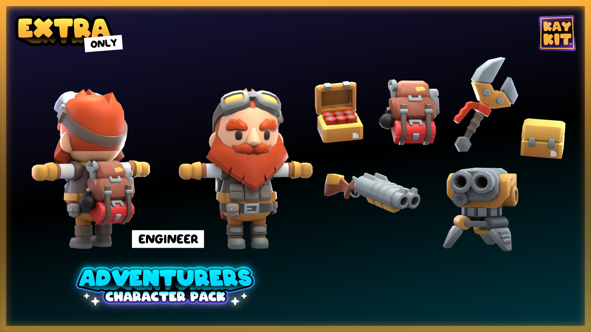

KayKit Adventurers · engineer · Kay Lousberg · [来源](https://github.com/KayKit-Game-Assets/KayKit-Character-Pack-Adventures-1.0) · CC0

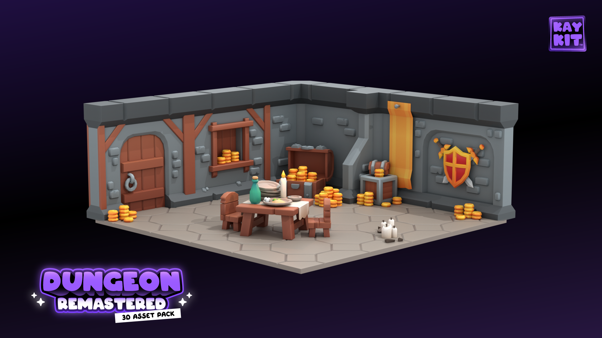

KayKit Dungeon Remastered 场景 1 · Kay Lousberg · [来源](https://github.com/KayKit-Game-Assets/KayKit-Dungeon-Remastered-1.0) · CC0

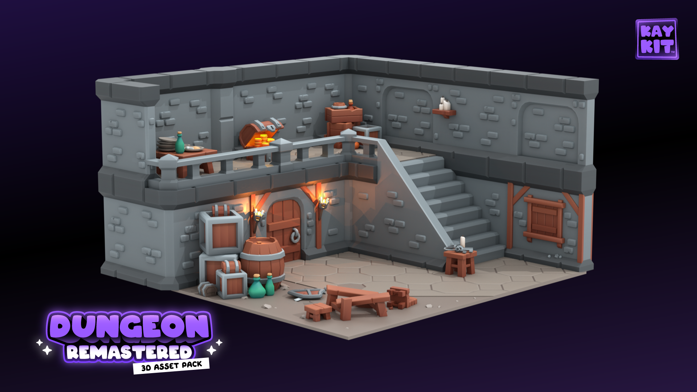

KayKit Dungeon Remastered 场景 2 · Kay Lousberg · [来源](https://github.com/KayKit-Game-Assets/KayKit-Dungeon-Remastered-1.0) · CC0

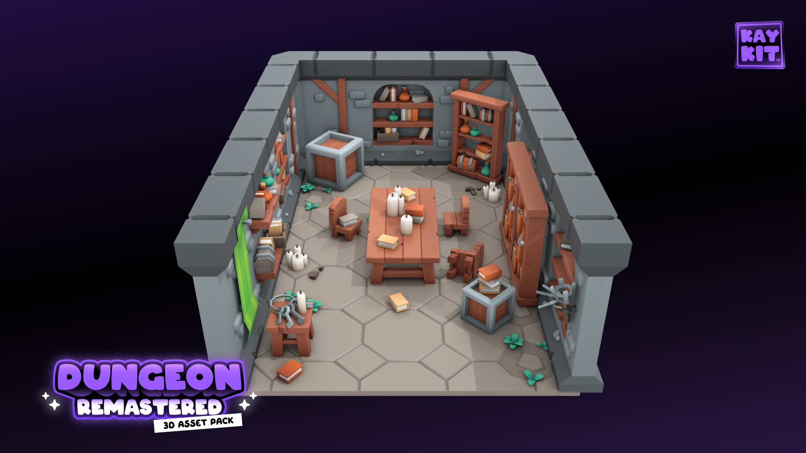

KayKit Dungeon Remastered 场景 3 · Kay Lousberg · [来源](https://github.com/KayKit-Game-Assets/KayKit-Dungeon-Remastered-1.0) · CC0

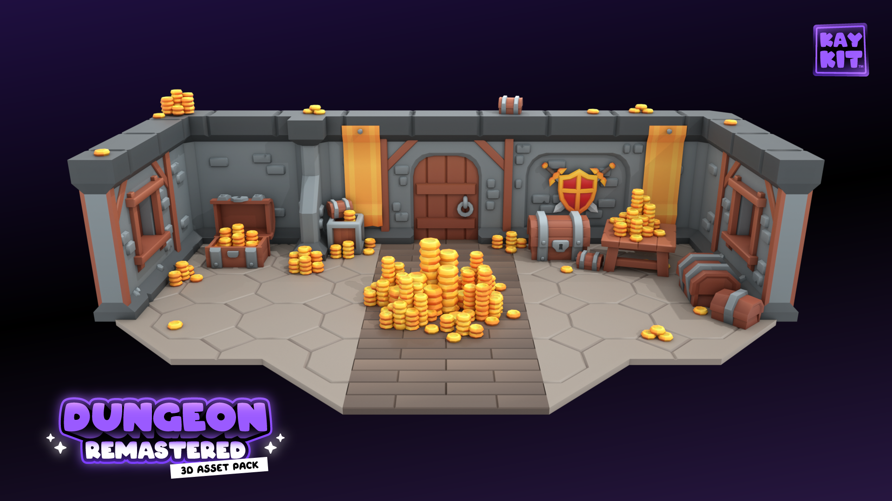

KayKit Dungeon Remastered 场景 4 · Kay Lousberg · [来源](https://github.com/KayKit-Game-Assets/KayKit-Dungeon-Remastered-1.0) · CC0

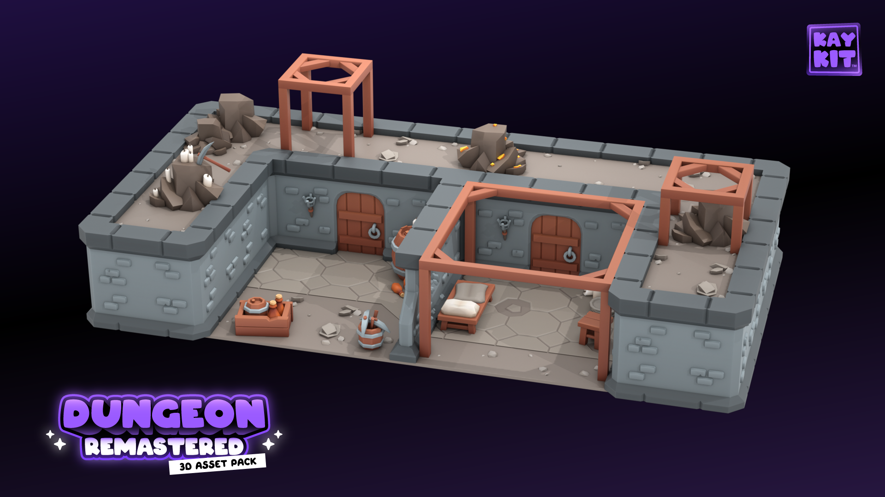

KayKit Dungeon Remastered 场景 10 · Kay Lousberg · [来源](https://github.com/KayKit-Game-Assets/KayKit-Dungeon-Remastered-1.0) · CC0

## 可直接用的素材文件

- [broadsword.svg](broadsword.svg)
- [crossed-swords.svg](crossed-swords.svg)
- [dragon-head.svg](dragon-head.svg)
- [health-potion.svg](health-potion.svg)
- [kaykit-Knight.glb](kaykit-Knight.glb)
- [treasure-map.svg](treasure-map.svg)

## 工具实测（tool-tests/）

我测试时做的拼图、录屏和截图，证明素材能用、方便复现，不代表素材本身的最好效果。

- [preview-game-icons.png](tool-tests/preview-game-icons.png)
- [preview-kaykit-knight.png](tool-tests/preview-kaykit-knight.png)
