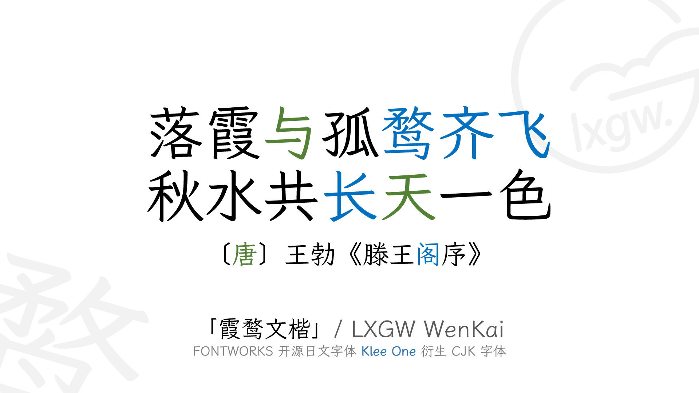
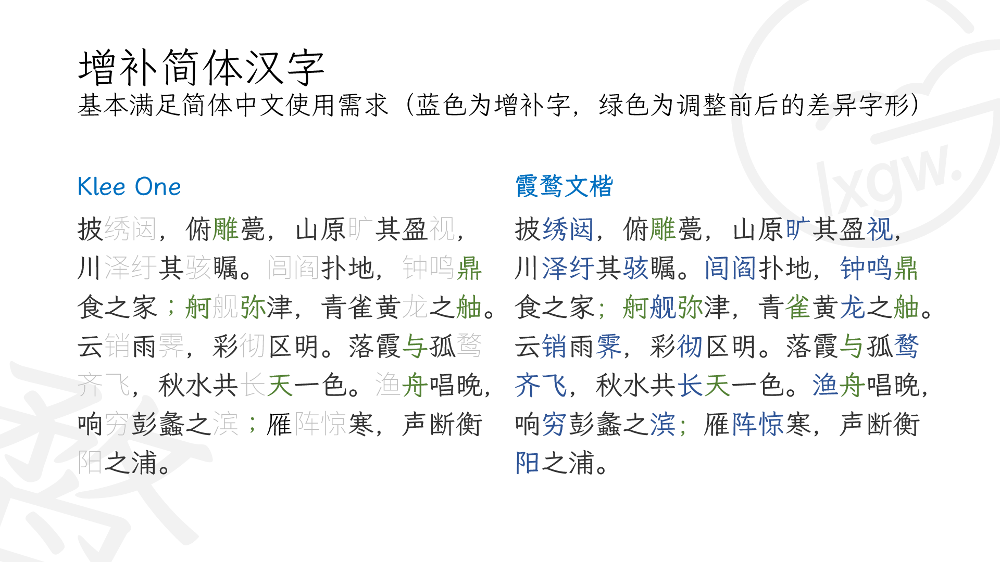
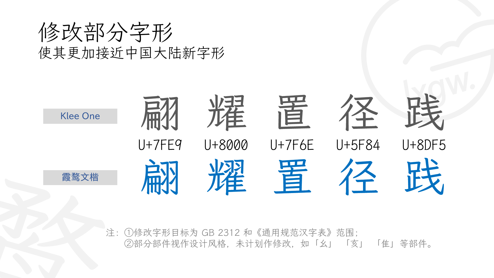
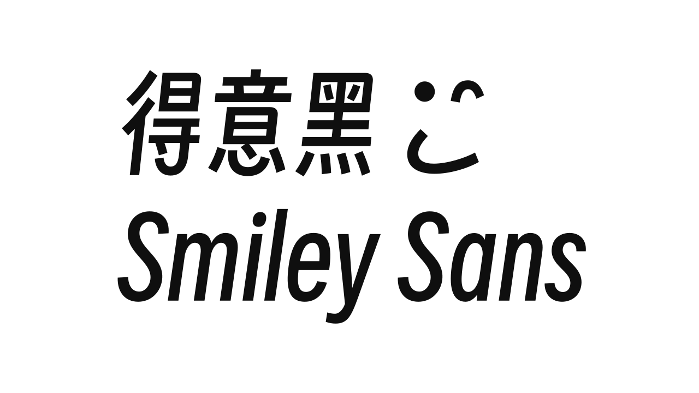

# 字体（全部可商用，注意各自的使用边界）

中文为主的免费可商用字体，按场景挑。

## 适合用在

见下表"用途"。

## 工具 / 资源

| 工具 | 链接 | 许可证 | 用途 | 状态 |
|---|---|---|---|---|
| 得意黑 Smiley Sans | [atelier-anchor/smiley-sans](https://github.com/atelier-anchor/smiley-sans) | OFL 1.1 | 标题、视频大字 | 已实测 |
| 霞鹜文楷 LXGW WenKai | [lxgw/LxgwWenKai](https://github.com/lxgw/LxgwWenKai) | OFL 1.1 | 正文、字幕（网页需子集化，原文件 25MB） | 已实测 |
| 融合像素 Fusion Pixel | [TakWolf/fusion-pixel-font](https://github.com/TakWolf/fusion-pixel-font) | OFL 1.1 | 像素游戏 UI | 已实测 |
| 站酷快乐体 ZCOOL KuaiLe | [fontsource](https://fontsource.org/fonts/zcool-kuaile) | OFL 1.1 | 手绘、可爱风 | 已实测 |
| Caveat | [fontsource](https://fontsource.org/fonts/caveat) | OFL 1.1 | 英文手写批注 | 已实测 |
| Instrument Serif | [fontsource](https://fontsource.org/fonts/instrument-serif) | OFL 1.1 | 米白高级感英文标题 | 已实测 |
| Sedgwick Ave | [Google Fonts](https://fonts.google.com/specimen/Sedgwick+Ave) | OFL 1.1 | 英文手写批注（Oliver 风格包） | 已实测 |
| 马善政 Ma Shan Zheng | [Google Fonts](https://fonts.google.com/specimen/Ma+Shan+Zheng) | OFL 1.1 | 中文手写批注，网页可用 | 已实测 |
| 平方江南体 | [猫啃网](https://www.maoken.com/freefonts/21901.html) | 作者声明免费商用；不许修改、未授权再分发 | 中文手写批注，只用于图片、封面、视频；不做网页字体，文件不入库 | 已实测 |

## 怎么复现示例

网页里用 `npm i @fontsource/<字体名>` 引入，自动按 unicode-range 分包，中文也不会太大。

## 按「不要做原则」使用

对应 [不要做原则](../../../04_规则与模板/不要做原则.md)。

- 画面里需要文字的地方，一律后期用这里的真字体排，不让模型画字。（§1、§8）
- 网页里中文字体用 @fontsource 分包或子集化，不要直接引 25MB 的 ttf。

## 官方展示图（official/）

直接取自各项目 GitHub 仓库的官方图，代表素材本来的质量。

霞鹜文楷官方样张 1 · LXGW · [来源](https://github.com/lxgw/LxgwWenKai) · OFL 1.1

霞鹜文楷官方样张 2 · LXGW · [来源](https://github.com/lxgw/LxgwWenKai) · OFL 1.1

霞鹜文楷官方样张 3 · LXGW · [来源](https://github.com/lxgw/LxgwWenKai) · OFL 1.1

霞鹜文楷官方样张 4 · LXGW · [来源](https://github.com/lxgw/LxgwWenKai) · OFL 1.1

融合像素字体官方横幅 · TakWolf · [来源](https://github.com/TakWolf/fusion-pixel-font) · OFL 1.1

得意黑官方字标 · atelierAnchor · [来源](https://github.com/atelier-anchor/smiley-sans) · OFL 1.1

## 可直接用的素材文件

- [SmileySans-Oblique.ttf](SmileySans-Oblique.ttf)
- [SmileySans-Oblique.woff2](SmileySans-Oblique.woff2)

## 工具实测（tool-tests/）

我测试时做的拼图、录屏和截图，证明素材能用、方便复现，不代表素材本身的最好效果。

- [specimen.png](tool-tests/specimen.png)
