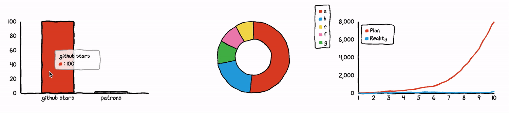

# 手绘涂鸦 · Sketch & Scribble

以铅笔、圆珠笔、马克笔的手绘线条和涂鸦为主体，保留线条抖动（boiling line）、重描、留白与纸面质感，刻意不完美的手作感。

> 用之前先对照 [不要做原则](../../../04_规则与模板/不要做原则.md)：§1 AI 味严重（画面里的字后期排）、§3 风格不一致。

## 参考作品（12 个，点链接看原作）

| # | 作品 | 作者 / 出品 | 年份 | 类型 | 适合 | 为什么值得参考 |
|---|---|---|---|---|---|---|
| 1 | [Take On Me (a-ha) 音乐录像带](https://en.wikipedia.org/wiki/Take_On_Me) | Steve Barron（导演） | 1985 | 视频 | 视频 | 铅笔素描转描（rotoscoping）与真人实拍交替的经典之作，约3000帧手工描线，获1986年MTV VMA六项大奖，是素描动态感的教科书。 |
| 2 | [Squigglevision（Dr. Katz / Home Movies）](https://en.wikipedia.org/wiki/Squigglevision) | Tom Snyder / Soup2Nuts | 1995 | 视频 | 视频、游戏 | 让轮廓线持续颤动的'抖线'动画技术，是 boiling line 风格的标准参照，适合低成本做出手绘呼吸感。 |
| 3 | [Paperman](https://en.wikipedia.org/wiki/Paperman) | John Kahrs / Walt Disney Animation Studios | 2012 | 视频 | 视频 | 用 Meander 系统把手绘线条叠加在CG上，获奥斯卡最佳动画短片，展示了'3D骨架+手绘线稿'的高级做法。 |
| 4 | [The Mitchells vs. the Machines（米切尔一家）](https://en.wikipedia.org/wiki/The_Mitchells_vs._the_Machines) | Sony Pictures Animation | 2021 | 视频 | 视频、网站 | 在3D画面上叠加2D涂鸦、潦草线条和水彩笔触（Katie-Vision），是把 doodle 当叙事语言使用的优秀长片范例。 |
| 5 | [Chicory: A Colorful Tale](https://chicorygame.com/) | Greg Lobanov 等 | 2021 | 游戏 | 游戏 | 黑白线稿世界由玩家用画笔上色，线稿即玩法，是独立游戏里'线条+涂色'风格的代表。 |
| 6 | [Pentiment](https://en.wikipedia.org/wiki/Pentiment_(video_game)) | Obsidian Entertainment | 2022 | 游戏 | 游戏、网站 | 以中世纪手抄本插图与木刻为视觉语言，获2023年皮博迪奖，示范了手绘线条如何承载叙事和UI。 |
| 7 | [Mr Doodle（Sam Cox）](https://www.mrdoodle.com/) | Sam Cox |  | 艺术家 | 网站、游戏、视频 | 单色、密集、无中心焦点的满版涂鸦，可直接作为涂鸦纹理、海报与场景铺满式构图的参照。 |
| 8 | [Rough.js](https://roughjs.com/) | Preet Shihn |  | 开源演示 | 网站、游戏 | 把线、圆、多边形、SVG路径渲染成手绘草图效果的轻量JS库，网页与小游戏可直接使用。（MIT（GitHub: rough-stuff/rough）） |
| 9 | [Excalidraw](https://excalidraw.com/) | Excalidraw 团队 |  | 开源演示 | 网站 | 手绘感白板工具，抖动线条和手写字体的UI范例，适合参考'草图感界面'的分寸。（MIT（GitHub: excalidraw/excalidraw）） |
| 10 | [Wired Elements](https://github.com/rough-stuff/wired-elements) | Preet Shihn |  | 开源演示 | 网站、游戏 | 一套手绘草图风的Web组件（按钮、输入框等），可直接做草稿感网站或游戏UI。（MIT） |
| 11 | [chart.xkcd](https://github.com/timqian/chart.xkcd) | Tim Qian | 2019 | 开源演示 | 网站 | xkcd漫画风的手绘图表库，适合在网站里用草图风展示数据。（MIT） |
| 12 | [How to Create Dynamic and Fun Line Boil Animations](https://www.premiumbeat.com/blog/how-to-create-line-boil-animations/) | Jason Boone / PremiumBeat | 2020 | 开源演示 | 视频、游戏 | 逐步讲解如何手工描线制作 line boil 循环（作者最终用8fps），是视频和游戏里做抖线的实操教程。 |

### 本地参考图

这几张来自开源仓库的官方展示图，可以直接打开看；其余作品版权在原作者，只放链接。



chart.xkcd 手绘图表演示 · Tim Qian · [来源](https://github.com/timqian/chart.xkcd) · MIT

## 公开提示词（6 条，原文照抄，附出处）

标「节选」的只抄到了开头，全文看出处。用的时候把主体换成你的，风格约束部分保留。

**1. Gemini 图像生成（官方文档示例）** · [出处](https://ai.google.dev/gemini-api/docs/image-generation)

```
Da Vinci style anatomical sketch of a dissected Monarch butterfly.
```

Google官方文档示例：用'达芬奇手稿式解剖素描'锁定笔记本草图语言，适合游戏图鉴/科普页。

**2. Midjourney** · [出处](https://docs.midjourney.com/hc/en-us/articles/32835253061645-Prompt-Basics)

```
Ballpoint Pen Sketch style cat
```

Midjourney官方 Prompt Basics 的媒介模板（「______ style cat」，此处填入其列出的 Ballpoint Pen Sketch）；用具体工具（圆珠笔）比笼统的'sketch'更可控，可换成 Pencil Sketch。

**3. Morphic 图像生成** · [出处](https://morphic.com/resources/images/doodle-ideas)

```
An open sketchbook page filled with scattered doodles of varying sizes, margins filled with small sketches.
```

满版速写本涂鸦页，适合网站背景纹理或游戏加载页。

**4. Morphic 图像生成** · [出处](https://morphic.com/resources/images/doodle-ideas)

```
A page of handwritten notes surrounded by decorative doodles in the margins, little sketches framing text.
```

手写笔记+页边涂鸦，适合独立网站的'笔记本'式版面参考。

**5. Morphic 图像生成** · [出处](https://morphic.com/resources/images/doodle-ideas)

```
A large canvas or board filled with overlapping doodles from multiple hands, layers of different styles.
```

多人叠加涂鸦墙，适合活动海报或视频转场素材。

**6. Midjourney** · [出处](https://openart.ai/blog/post/midjourney-prompts-for-pencil-sketch)

```
Pencil sketch of a serene forest landscape, detailed trees and foliage, realistic shading.
```

OpenArt 博客铅笔素描提示词；偏写实，若要涂鸦感需去掉 realistic shading，改为 loose lines/unfinished。

## Midjourney 风格代码（--sref）

社区整理的代码，不同 Midjourney 版本效果会漂移，先小批量试。

| 代码 | 说明 | 出处 |
|---|---|---|
| `--sref 3521545739` | Monochrome Scribble Art：单色乱线涂鸦（社区上传，注意 sref 在不同MJ版本下效果会漂移）。 | [链接](https://sref-midjourney.com/style/scribble) |
| `--sref 3819588992` | Chaotic Cartoon Buzz：混乱卡通涂鸦线条。 | [链接](https://sref-midjourney.com/style/scribble) |
| `--sref 800035` | Sketchy Line Art Vibes：松散草图线稿。 | [链接](https://sref-midjourney.com/style/pencil%20sketch) |
| `--sref 1246700902` | Storybook Ink：奶油色纸上的黑色墨水涂鸦，童书感。 | [链接](https://moodboard.beehiiv.com/p/10-more-styles-to-steal) |
| `--sref 35639047` | Technical Sketch：带注释的黑白手稿/设计草图，类似文艺复兴笔记本。 | [链接](https://moodboard.beehiiv.com/p/10-more-styles-to-steal) |
| `--sref 3455046537` | Minimalist Ink Illustration：高对比黑白手绘墨线。 | [链接](https://moodboard.beehiiv.com/p/10-midjourney-style-codes-you-can-copy-paste) |

## 这个风格的「不要做」

- 不要画过于细致写实的主体；涂鸦风适合简化、夸张、富表现力的造型，写实细节会变成普通素描插画。（[来源](https://morphic.com/resources/images/doodle-ideas)）
- 只写'sketch'容易得到干净的灰度素描；要写明具体工具（圆珠笔、铅笔、马克笔）、纸面和线条状态。（[来源](https://docs.midjourney.com/hc/en-us/articles/32835253061645-Prompt-Basics)）
- 抖线（line boil）不要每帧24fps乱抖：用3-4张描线循环、低帧率（教程作者用8fps），抖动幅度靠描线精度控制。（[来源](https://www.premiumbeat.com/blog/how-to-create-line-boil-animations/)）
- 系列图要锁定线宽、配色和笔触（风格迁移/固定sref），否则同一项目里的涂鸦会像出自不同人之手。（[来源](https://morphic.com/resources/images/doodle-ideas)）

## 做出这种风格的工具

| 工具 | 链接 | 许可证 | 用途 | 状态 |
|---|---|---|---|---|
| rough.js | [rough-stuff/rough](https://github.com/rough-stuff/rough) | MIT | 网页手绘风图形 | 已实测 |
| Rough Notation | [rough-stuff/rough-notation](https://github.com/rough-stuff/rough-notation) | MIT | 文字手绘圈注/下划线动画 | 已核对 |
| roughViz | [jwilber/roughViz](https://github.com/jwilber/roughViz) | MIT | 手绘风图表 | 已核对 |
| Excalidraw | [excalidraw/excalidraw](https://github.com/excalidraw/excalidraw) | MIT | 手绘白板，可嵌入 | 已核对 |
| perfect-freehand | [steveruizok/perfect-freehand](https://github.com/steveruizok/perfect-freehand) | MIT | 有压感的笔触 | 已核对 |
| Caveat / 站酷快乐体 | fontsource | OFL | 手写字体 | 已实测 |
| ImageMagick -sketch | https://imagemagick.org | Apache-2.0 风格 | 照片转铅笔素描 | 已实测 |

## 工具实测（tool-tests/）

这些是我用上面的开源工具在 CC0/公有领域测试图上跑出来的，只用来证明工具能做到这个效果、方便你复现参数，**不是风格标杆**，风格以上面的参考作品为准。

- [magick-pencil-sketch-chelsea.png](tool-tests/magick-pencil-sketch-chelsea.png)
- [roughjs-ui-sketch.png](tool-tests/roughjs-ui-sketch.png)
