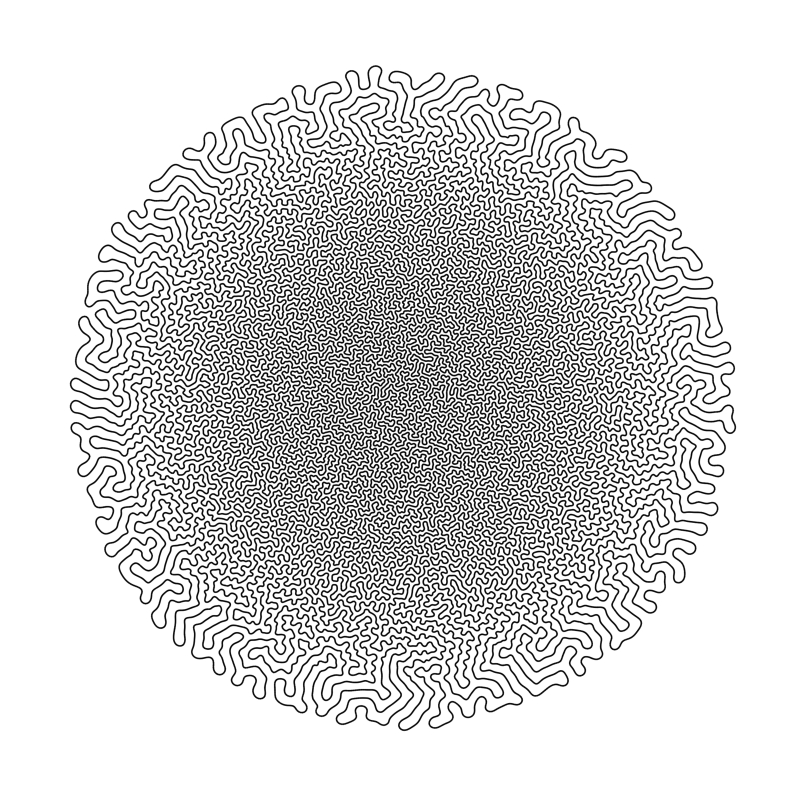
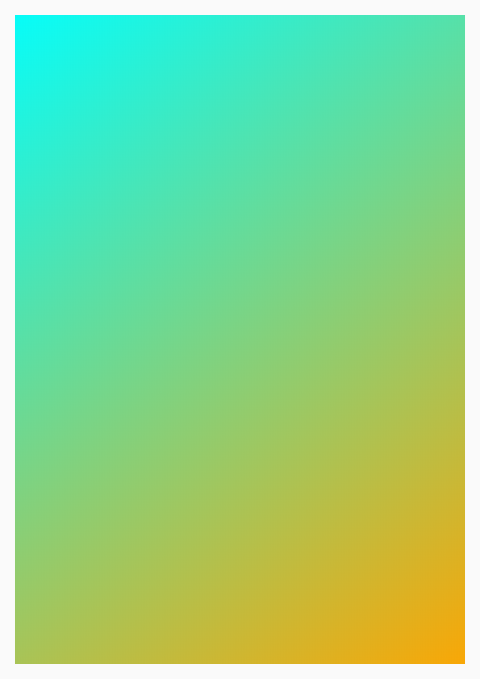

# 生成艺术 · Generative Art

由代码与规则生成的图像：流场、粒子、噪声等高线、Voronoi、笔式绘图仪线稿等，强调系统性、可变参数与'同一算法的一组变体'。

> 用之前先对照 [不要做原则](../../../04_规则与模板/不要做原则.md)：§3 风格不一致、§4 质量不稳定。

## 参考作品（12 个，点链接看原作）

| # | 作品 | 作者 / 出品 | 年份 | 类型 | 适合 | 为什么值得参考 |
|---|---|---|---|---|---|---|
| 1 | [Fidenza](https://www.tylerxhobbs.com/words/fidenza) | Tyler Hobbs | 2021 | 作品 | 网站、视频、游戏 | Art Blocks 上最具代表性的流场生成艺术：不重叠的粗曲线条带沿流场排布，是流场美学的标杆。 |
| 2 | [Flow Fields（教程文章）](https://www.tylerxhobbs.com/words/flow-fields) | Tyler Hobbs | 2020 | 开源演示 | 网站、游戏 | Fidenza作者亲写的流场原理与参数讲解（步长、曲线长度、起点分布、噪声变形），落地实现必读。 |
| 3 | [Zach Lieberman](https://zach.li/) | Zach Lieberman |  | 艺术家 | 视频、网站 | openFrameworks 联合创建者、诗意计算学校创办人，日更的代码动画草图是生成艺术动态表现的重要参考。 |
| 4 | [Vera Molnár](https://en.wikipedia.org/wiki/Vera_Moln%C3%A1r) | Vera Molnár | 1968 | 艺术家 | 网站、游戏 | 1968年起用计算机做算法绘画的先驱，几何网格+微小随机扰动是极简生成艺术的源头。 |
| 5 | [Inconvergent（Anders Hoff）](https://inconvergent.net/) | Anders Hoff |  | 艺术家 | 网站、视频 | 以简单规则生成复杂形态、大量笔式绘图仪作品著称，适合'有机生长线条'参考。 |
| 6 | [differential-line](https://github.com/inconvergent/differential-line) | Anders Hoff (inconvergent) |  | 开源演示 | 网站、游戏、视频 | 差分生长线条算法的开源实现，产出类似珊瑚/肠道的有机褶皱线条。（MIT） |
| 7 | [Refik Anadol: Unsupervised](https://www.moma.org/calendar/exhibitions/5535) | Refik Anadol / MoMA | 2022 | 作品 | 视频、网站 | MoMA展出的实时AI数据雕塑，基于馆藏数据生成流体般影像，是大屏生成影像的顶级案例。 |
| 8 | [Generated Space](https://generated.space/) | Kjetil Golid |  | 网站 | 网站 | 生成艺术家的作品集网站，每件作品都是可交互的生成草图，网站与作品合一的优秀范例。 |
| 9 | [Field Play](https://anvaka.github.io/fieldplay/) | Andrei Kashcha (anvaka) |  | 开源演示 | 网站、视频 | 在浏览器里实时编辑向量场方程并观察粒子流动，适合快速探索流场视觉。（MIT（GitHub: anvaka/fieldplay）） |
| 10 | [canvas-sketch](https://github.com/mattdesl/canvas-sketch) | Matt DesLauriers |  | 开源演示 | 网站、视频 | 专为生成艺术设计的JS框架，支持高分辨率导出、打印尺寸与动画录制。（MIT） |
| 11 | [No Man's Sky](https://en.wikipedia.org/wiki/No_Man%27s_Sky) | Hello Games | 2016 | 游戏 | 游戏 | 用单一种子程序化生成星球、植物与动物，配合70-80年代科幻封面配色，是游戏里程序化生成的代表。 |
| 12 | [Nervous System](https://n-e-r-v-o-u-s.com/) | Nervous System |  | 艺术家 | 网站 | 用计算机模拟生成自然形态的设计工作室（拼图、首饰等），展示生成艺术如何落到实体产品。 |

### 本地参考图

这几张来自开源仓库的官方展示图，可以直接打开看；其余作品版权在原作者，只放链接。



differential-line · Anders Hoff (inconvergent) · [来源](https://github.com/inconvergent/differential-line) · MIT



canvas-sketch 示例 · Matt DesLauriers · [来源](https://github.com/mattdesl/canvas-sketch) · MIT

## 公开提示词（5 条，原文照抄，附出处）

标「节选」的只抄到了开头，全文看出处。用的时候把主体换成你的，风格约束部分保留。

**1. Morphic 图像生成** · [出处](https://morphic.com/resources/images/generative-art-image)

```
A full composition, a large flow-field of thousands of curving lines drifting across the frame in a muted palette, density gathering into a soft central band.
```

流场海报；'density gathering into a soft central band' 主动控制疏密，避免均匀铺满。

**2. Morphic 图像生成** · [出处](https://morphic.com/resources/images/generative-art-image)

```
A full composition, a wall-scale Voronoi mosaic packed edge to edge, flat gradient tones per shard, thin dark seams tracing the cell boundaries.
```

Voronoi 镶嵌墙面，适合网站背景或游戏地面纹理。

**3. Morphic 图像生成** · [出处](https://morphic.com/resources/images/generative-art-image)

```
A full composition, a wide spread of nested noise contour lines flowing like a height map, warm sand tones on pale ground, denser loops toward the peaks.
```

噪声等高线地形图，暖沙色+浅底，适合米白/纸感版面。

**4. Morphic 图像生成** · [出处](https://morphic.com/resources/images/generative-art-image)

```
A full composition, a dark field with a bright particle swarm collapsing into a smoky attractor shape,
```

粒子吸引子（页面上为节选开头，完整版见来源页）；适合AI视频的粒子聚合镜头。

**5. Morphic 图像生成** · [出处](https://morphic.com/resources/images/generative-art-image)

```
Flow-field generative art, drifting lines, muted pastel palette
```

最短风格关键词组合，可附加在其他提示后作为风格修饰。

## 这个风格的「不要做」

- 不要直接'用 Perlin 噪声就完事'——它已被用滥；应设计自己的场变形方式（Fidenza 作者原话建议）。（[来源](https://www.tylerxhobbs.com/words/flow-fields)）
- 流场起点纯均匀随机会产生不想要的结块和空洞；步长过大会出现尖角，曲线过长会把一种颜色拖进另一种颜色的区域。（[来源](https://www.tylerxhobbs.com/words/flow-fields)）
- 不要让图案密度处处一致；要指定哪里变密、哪里变疏，以此引导构图。（[来源](https://morphic.com/resources/images/generative-art-image)）
- 系列作品不锁定调色板和母题，会变成一组互不相关的抽象图；生成艺术的价值在于'同一系统的变体'。（[来源](https://morphic.com/resources/images/generative-art-image)）
- 不要停在第一版'白底黑色流线'的默认效果；改变笔触形状、端点、透明度、配色逻辑和噪声尺度，而不只是增加粒子数。（[来源](https://sighack.com/post/getting-creative-with-perlin-noise-fields)）

## 做出这种风格的工具

| 工具 | 链接 | 许可证 | 用途 | 状态 |
|---|---|---|---|---|
| p5.js | [processing/p5.js](https://github.com/processing/p5.js) | LGPL-2.1 | 最好上手的创意编程库 | 已实测 |
| canvas-sketch | [mattdesl/canvas-sketch](https://github.com/mattdesl/canvas-sketch) | MIT | 生成艺术工作流（导出高清/视频） | 已核对 |
| three.js | [mrdoob/three.js](https://github.com/mrdoob/three.js) | MIT | 3D 生成 | 已核对 |
| Hydra | [hydra-synth/hydra](https://github.com/hydra-synth/hydra) | AGPL-3.0（改了代码要开源） | 实时视频合成，做 VJ 视觉 | 已核对 |
| React Bits：Galaxy / Threads / Particles / Waves 等 60 个背景 | [DavidHDev/react-bits](https://github.com/DavidHDev/react-bits) | MIT + Commons Clause | 网页直接用的同风格组件 | 已核对 |

## 工具实测（tool-tests/）

这些是我用上面的开源工具在 CC0/公有领域测试图上跑出来的，只用来证明工具能做到这个效果、方便你复现参数，**不是风格标杆**，风格以上面的参考作品为准。

- [gen.html](tool-tests/gen.html)
- [p5-circle-packing.png](tool-tests/p5-circle-packing.png)
- [p5-flowfield-grow.mp4](tool-tests/p5-flowfield-grow.mp4)
- [p5-flowfield.png](tool-tests/p5-flowfield.png)
- [p5-truchet-tiles.png](tool-tests/p5-truchet-tiles.png)
