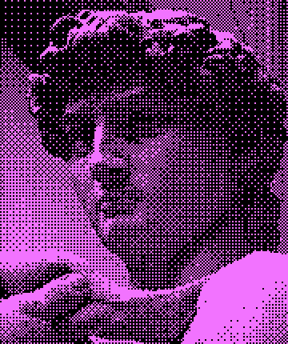

# 抖动与半调 · Dither & Halftone（补充）

用黑白（或极少色）点阵的疏密排列——有序/Bayer 抖动、误差扩散或网点——来模拟灰阶与光影的印刷/早期屏幕质感。

> 用之前先对照 [不要做原则](../../../04_规则与模板/不要做原则.md)：§5 像素图是假像素（抖动同样要整数倍缩放、固定调色板）。

## 参考作品（10 个，点链接看原作）

| # | 作品 | 作者 / 出品 | 年份 | 类型 | 适合 | 为什么值得参考 |
|---|---|---|---|---|---|---|
| 1 | [Return of the Obra Dinn](https://obradinn.com/) | Lucas Pope | 2018 | 游戏 | 游戏、视频 | 1-bit 抖动 3D 游戏的终极标杆，证明抖动可承载完整叙事与氛围。 |
| 2 | [Obra Dinn 开发日志：抖动稳定化帖子](https://forums.tigsource.com/index.php?topic=40832.msg1363742#msg1363742) | Lucas Pope（dukope） |  | 作品 | 游戏 | 作者亲述如何让抖动在镜头移动时不闪烁，是 3D 抖动着色器的必读技术参考。 |
| 3 | [WORLD OF HORROR](https://store.steampowered.com/app/913740/WORLD_OF_HORROR/) | panstasz | 2023 | 游戏 | 游戏、视频 | 全部用 MS Paint 绘制的“stark 1-bit”恐怖风，伊藤润二式网点/抖动阴影参考。 |
| 4 | [Playdate](https://play.date/) | Panic |  | 游戏 | 游戏 | 400×240 1-bit 掌机，整个生态都是 1-bit 抖动美术的活样本库。 |
| 5 | [Low-tech Magazine 太阳能网站](https://solar.lowtechmagazine.com/about/the-solar-website/) | Low-tech Magazine |  | 网站 | 网站 | 把所有图片做成抖动图再按栏目着色，体积约降为 1/10，网站用抖动的经典案例。 |
| 6 | [Ditherpunk — The article I wish I had about monochrome image dithering](https://surma.dev/things/ditherpunk/) | Surma | 2021 | 作品 | 网站、游戏 | 系统讲解阈值、Bayer、蓝噪声、Floyd-Steinberg、Atkinson 等算法并附对比图，是团队技术基准。 |
| 7 | [didder](https://github.com/makew0rld/didder) | makew0rld |  | 开源演示 | 网站、游戏、视频 | 命令行精确抖动工具（多种算法/自定义调色板），可批量把素材转为统一抖动风。（GPL-3.0） |
| 8 | [Surface-Stable Fractal Dithering（Dither3D）](https://runevision.com/tech/dither3d) | Rune Skovbo Johansen |  | 开源演示 | 游戏、视频 | 在 Obra Dinn 基础上让抖动点贴合表面、移动不游走，3D 抖动游戏/视频的开源方案。（源码 github.com/runevision/Dither3D，MPL-2.0） |
| 9 | [Spider-Man: Into the Spider-Verse（网点/Ben-Day 点与排线渲染）](https://www.awn.com/print/animationworld/rewriting-visual-rule-book-spider-man-spider-verse) | Sony Pictures Animation / Imageworks | 2018 | 视频 | 视频 | 把印刷网点、排线做成动画渲染语言，是“半调网点做动态影像”的顶级参考。 |
| 10 | [Drowning Girl](https://en.wikipedia.org/wiki/Drowning_Girl) | Roy Lichtenstein | 1963 | 作品 | 网站、视频 | 波普艺术中 Ben-Day 网点的代表作（MoMA 藏），半调网点海报/主视觉的源头参考。 |

### 本地参考图

这几张来自开源仓库的官方展示图，可以直接打开看；其余作品版权在原作者，只放链接。



didder 抖动示例（大卫像） · makew0rld · [来源](https://github.com/makew0rld/didder) · GPL-3.0

## 公开提示词（5 条，原文照抄，附出处）

标「节选」的只抄到了开头，全文看出处。用的时候把主体换成你的，风格约束部分保留。

**1. FLUX.1-dev + glif/dithering LoRA（Yerko Lucic）** · [出处](https://huggingface.co/glif/dithering)

```
a lighthouse standing tall against the ocean waves in ATKSN style
```

1-bit Atkinson 抖动 LoRA，触发词 "in ATKSN style"，强度 1.0；许可 CC0-1.0。

**2. FLUX.1-dev + glif/dithering LoRA** · [出处](https://huggingface.co/glif/dithering)

```
illustration, a large black cat sitting on a windowsill in ATKSN style
```

模型卡提示：插画类提示词可能输出彩色但仍保留抖动纹理。

**3. Midjourney（论坛用户 retr01 实测）** · [出处](https://tinkerdifferent.com/threads/mu0ns-midjourney-outputs.2684/)

```
Draw a 512x342 pixel image with a maximum resolution of 72 dots per inch in 1 bit black and white.
```

用原版 Macintosh 的 512×342 分辨率与 1-bit 作为硬约束。

**4. Midjourney（论坛用户 Crutch 实测）** · [出处](https://tinkerdifferent.com/threads/mu0ns-midjourney-outputs.2684/)

```
32 x 32 bitmap icons, using only pure white and pure black, in the style of Susan Kare….
```

明确尺寸+纯黑白+Susan Kare 早期 Mac 图标风，适合做网站/UI 1-bit 图标。

**5. FLUX.1-dev + Halftone-Recraft-Flux LoRA（strangerzonehf）** · [出处](https://huggingface.co/strangerzonehf/Halftone-Recraft-Flux)

```
Halftone Recraft, A black and white photograph of a white sports car on a road. The car is facing the left side of the frame. There is a yellow bus behind the car. The bus has a red stripe on the side of it. There are black letters on the top of the bus.
```

半调网点 LoRA，触发词 "Halftone Recraft"；许可 creativeml-openrail-m。

## Midjourney 风格代码（--sref）

社区整理的代码，不同 Midjourney 版本效果会漂移，先小批量试。

| 代码 | 说明 | 出处 |
|---|---|---|
| `--sref --sref 2395769938` | “Geometric Collage Mix”：分层几何形+半调网点纹理，黑/青/浅粉配色（偏拼贴，非纯 1-bit）。 | [链接](https://moodboard.beehiiv.com/p/10-midjourney-style-codes-you-can-copy-paste) |

## 这个风格的「不要做」

- 不要在 sRGB（gamma）空间直接抖动：会让渐变整体偏亮，应先转线性 RGB 再量化。（[来源](https://surma.dev/things/ditherpunk/)）
- 警惕 Bayer 有序抖动的十字/网格纹（crosshatch）：大面积平滑渐变可改用蓝噪声阈值图。（[来源](https://en.wikipedia.org/wiki/Ordered_dithering)）
- 3D/镜头运动时不要用屏幕空间固定抖动：点阵会“游走”闪烁，需把抖动锚定到场景/表面。（[来源](https://forums.tigsource.com/index.php?topic=40832.msg1363742#msg1363742)）
- 不要让 2×2 棋盘格等抖动图案每次滚动 1 像素：黑白互换会造成闪屏，应按 2 像素倍数滚动或用不随位移变化的图案。（[来源](https://help.play.date/developer/designing-for-playdate/)）
- 自动转换的抖动图往往很“噪”，关键素材要手工清理；细笔画至少 2px，小于约 32×32 的精灵难以辨认。（[来源](https://help.play.date/developer/designing-for-playdate/)）

## 做出这种风格的工具

| 工具 | 链接 | 许可证 | 用途 | 状态 |
|---|---|---|---|---|
| didder | [makew0rld/didder](https://github.com/makew0rld/didder) | GPL-3.0 | 命令行各种抖动算法 | 已核对 |
| ImageMagick -ordered-dither | https://imagemagick.org | Apache-2.0 风格 | 一行命令抖动 | 已实测（等效实现） |
| React Bits：Dither / HalftoneReveal / DotGrid | [DavidHDev/react-bits](https://github.com/DavidHDev/react-bits) | MIT + Commons Clause | 网页直接用的同风格组件 | 已核对 |

## 工具实测（tool-tests/）

这些是我用上面的开源工具在 CC0/公有领域测试图上跑出来的，只用来证明工具能做到这个效果、方便你复现参数，**不是风格标杆**，风格以上面的参考作品为准。

- [bayer-duotone.png](tool-tests/bayer-duotone.png)
- [floyd-steinberg-1bit.png](tool-tests/floyd-steinberg-1bit.png)
- [halftone-dots.png](tool-tests/halftone-dots.png)
