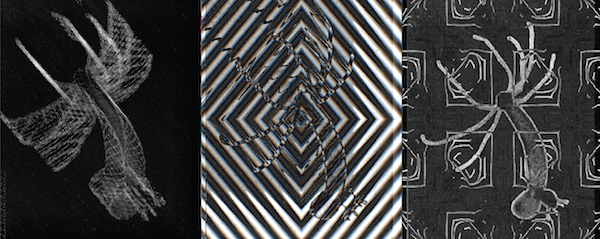

# 故障与 CRT · Glitch & CRT（补充）

借用数字压缩错误、数据混合（datamosh）、RGB 错位与 CRT/VHS 扫描线、荧光、磁带噪声等“媒介故障”作为美学语言的风格。

> 用之前先对照 [不要做原则](../../../04_规则与模板/不要做原则.md)：§7 独立站专项（减少动效）、§1 AI 味严重。

## 参考作品（10 个，点链接看原作）

| # | 作品 | 作者 / 出品 | 年份 | 类型 | 适合 | 为什么值得参考 |
|---|---|---|---|---|---|---|
| 1 | [Rosa Menkman（A Vernacular of File Formats / Glitch Studies Manifesto / The Glitch Moment(um)）](https://en.wikipedia.org/wiki/Rosa_Menkman) | Rosa Menkman | 2011 | 艺术家 | 网站、视频 | 故障艺术理论与实践的核心人物，其文件格式故障图谱被 Stedelijk 收藏，是分类各种压缩伪影的源头参考。 |
| 2 | [wwwwwwwww.jodi.org](https://en.wikipedia.org/wiki/Jodi_(art_collective)) | JODI（Joan Heemskerk & Dirk Paesmans） |  | 网站 | 网站 | 最早的网络艺术之一，用“坏掉的”HTML 造出视觉景观，故障风网站的祖师级参考。（作品站点 wwwwwwwww.jodi.org（本环境未能直接抓取，经维基百科确认）） |
| 3 | [Monster Movie](https://www.eai.org/titles/monster-movie) | Takeshi Murata | 2005 | 视频 | 视频 | 逐帧处理 1981 年电影《Caveman》使画面每秒“分解重组”30 次，datamosh 视频艺术代表作（EAI 发行）。 |
| 4 | [Kanye West – Welcome to Heartbreak（MV）](https://en.wikipedia.org/wiki/Welcome_to_Heartbreak) | 导演 Nabil Elderkin | 2009 | 视频 | 视频 | 把 datamosh 带入主流 MV 的标志性作品，像素拖影/帧间融合的范本。 |
| 5 | [Chairlift – Evident Utensil（MV）](https://motionographer.com/2009/02/19/tintori-and-nabil-breaking-your-internets/) | 导演 Ray Tintori | 2009 | 视频 | 视频 | Motionographer 评为把 datamosh 用得“轻盈、迷幻”的代表，与上条形成粗粝/明快两种参照。 |
| 6 | [Kung Fury](https://en.wikipedia.org/wiki/Kung_Fury) | David Sandberg | 2015 | 视频 | 视频 | 全片加入录像带磨损效果，模拟老 VCR 播放的 VHS 质感，80s 复古视频的高完成度参考。 |
| 7 | [SIGNALIS](https://store.steampowered.com/app/1262350/SIGNALIS/) | rose-engine | 2022 | 游戏 | 游戏 | “retrotech”复古科技恐怖游戏，低保真 3D+屏幕干扰与界面噪声的现代参考。 |
| 8 | [cool-retro-term](https://github.com/Swordfish90/cool-retro-term) | Swordfish90 |  | 开源演示 | 网站、视频 | 模拟老式阴极射线管终端（荧光拖影、扫描线、弧面、琥珀/绿色配色）的开源终端。（仓库含 GPL-2.0/GPL-3.0 文件） |
| 9 | [libretro slang-shaders（crt 目录：crt-royale、crt-geom 等）](https://github.com/libretro/slang-shaders) | libretro 社区 |  | 开源演示 | 游戏、视频 | RetroArch 的 CRT 着色器合集，游戏中做真实 CRT 遮罩/扫描线的工业级实现参考。 |
| 10 | [Hydra](https://github.com/hydra-synth/hydra) | Olivia Jack 与社区 |  | 开源演示 | 网站、视频 | 浏览器实时视频合成/直播编码，可做 RGB 错位、反馈、调制等故障视觉，网站与 VJ 视频皆可用。（AGPL-3.0） |

### 本地参考图

这几张来自开源仓库的官方展示图，可以直接打开看；其余作品版权在原作者，只放链接。



Hydra 实时视觉 · Olivia Jack 与社区 · [来源](https://github.com/hydra-synth/hydra) · AGPL-3.0

## 公开提示词（6 条，原文照抄，附出处）

标「节选」的只抄到了开头，全文看出处。用的时候把主体换成你的，风格约束部分保留。

**1. Krea（页面未注明具体模型）** · [出处](https://www.krea.ai/feed/lo-fi-analog-vhs-glitch-aesthetic-a-winding-path-beside-00832394-349d-5b7e-b356-7507778fdd94)

```
lo-fi analog vhs glitch aesthetic, a winding path beside silhouettes of trees, a still body of water, a lone isolated structure, heavy horizontal crt scan lines, chromatic aberration with cyan and magenta fringing, horizontal tracking errors, digital signal noise, muted palette with pink and yellow light leaks, deep contrast with thick black bands, grainy texture, distorted horizon, haunting atmospheric cinematography, glowing highlights, nostalgic and eerie surveillance footage feel
```

逐项点名扫描线、青/品红色差、跟踪误差、漏光等具体伪影，是写 VHS 提示词的好模板。

**2. SDXL + Aether Glitch LoRA（joachimsallstrom）** · [出处](https://huggingface.co/joachimsallstrom/aether-glitch-lora-for-sdxl)

```
vhs glitch man on a mountain looking at the sunset, cinematic, black background
```

触发词 "vhs glitch"；模型卡称调节 LoRA 权重可在“故障”与“CRT 电视”效果之间平衡。

**3. SDXL + Aether Glitch LoRA** · [出处](https://huggingface.co/joachimsallstrom/aether-glitch-lora-for-sdxl)

```
vhs glitch found footage of horror girl in the woods, cinematic, hires 8k, intricate, black background
```

“found footage”语境可强化录像带恐怖感。

**4. LTX-2.3 22B + crtanim 视频 LoRA（lovis93）** · [出处](https://huggingface.co/lovis93/crt-animation-terminal-ltx-2.3-lora)

```
crtanim, a dense CRT terminal typing "$ claude --continue" in glowing green pixel font, scanlines, phosphor glow, low choppy frame rate.
```

AI 视频用：触发词放首位；1024×1024；屏幕文字保持 1–3 个词；需关闭 prompt expansion。Apache-2.0。

**5. Wan2.1-T2V-14B + vintage-vhs LoRA（remade-ai）** · [出处](https://huggingface.co/remade-ai/vintage-vhs)

```
vh5_c4m3r4 old VHS style, the video shows a sandy beach with large rocks and a blue sky with some clouds. The waves are …
```

（节选，完整原文见来源页）AI 视频用；原文后续描述浪花、行人与“水平线条+边缘彩点”的失真。Apache-2.0。

**6. GPT Image 2（Carat 提示词库 #13649）** · [出处](https://carat.im/en/prompt-gallery/p/13649)

```
photograph. A frame from paused VHS tape on CRT. Horizontal scan lines. RGB fringing. … heavy RGB channel separation, pixel sorting artifacts, datamosh distortions, neon cyan and magenta color shifts, …
```

（节选，完整原文见来源页）把“暂停的 VHS 帧在 CRT 上”作为介质设定，再叠加像素排序/datamosh；原文含 4:3 与 no text/no watermark 等排除项。

## 这个风格的「不要做」

- 故障闪烁不得超过每秒 3 次（超过一般/红色闪光阈值时），否则有光敏性癫痫风险。（[来源](https://www.w3.org/WAI/WCAG21/Understanding/three-flashes-or-below-threshold.html)）
- 网站上的故障/扫描线动效必须响应 prefers-reduced-motion，为减少动态的用户关闭或降级。（[来源](https://developer.mozilla.org/en-US/docs/Web/CSS/@media/prefers-reduced-motion)）
- CRT 扫描线不要配非整数缩放：光束轮廓采样错位会导致扫描线粗细不均、出现摩尔纹，应使用整数纵向缩放。（[来源](https://forums.libretro.com/t/uneven-scanlines-when-integer-is-disabled/1290)）
- AI 生成 CRT/终端画面时屏幕文字不要太长（约 1–3 个词），且默认负面词可能破坏文字可读性。（[来源](https://huggingface.co/lovis93/crt-animation-terminal-ltx-2.3-lora)）

## 做出这种风格的工具

| 工具 | 链接 | 许可证 | 用途 | 状态 |
|---|---|---|---|---|
| glitch-canvas | [snorpey/glitch-canvas](https://github.com/snorpey/glitch-canvas) | MIT | 网页图片故障化 | 已核对 |
| postprocessing（GlitchEffect / ScanlineEffect） | [pmndrs/postprocessing](https://github.com/pmndrs/postprocessing) | Zlib | three.js 后期 | 已核对 |
| React Bits：FaultyTerminal / LetterGlitch / CRTWarp / GlitchText | [DavidHDev/react-bits](https://github.com/DavidHDev/react-bits) | MIT + Commons Clause | 网页直接用的同风格组件 | 已核对 |

## 工具实测（tool-tests/）

这些是我用上面的开源工具在 CC0/公有领域测试图上跑出来的，只用来证明工具能做到这个效果、方便你复现参数，**不是风格标杆**，风格以上面的参考作品为准。

- [crt-glitch-astronaut.mp4](tool-tests/crt-glitch-astronaut.mp4)
- [glitch-rgbsplit-scanlines.png](tool-tests/glitch-rgbsplit-scanlines.png)
